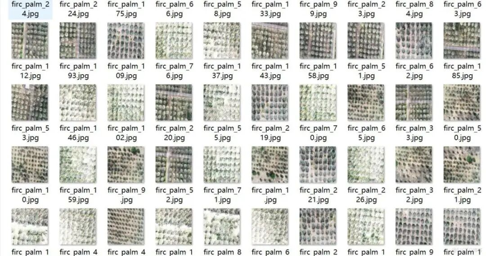
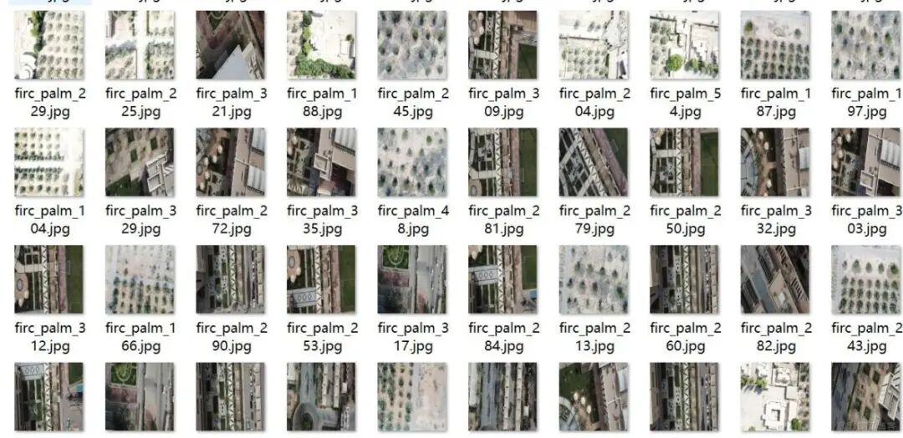
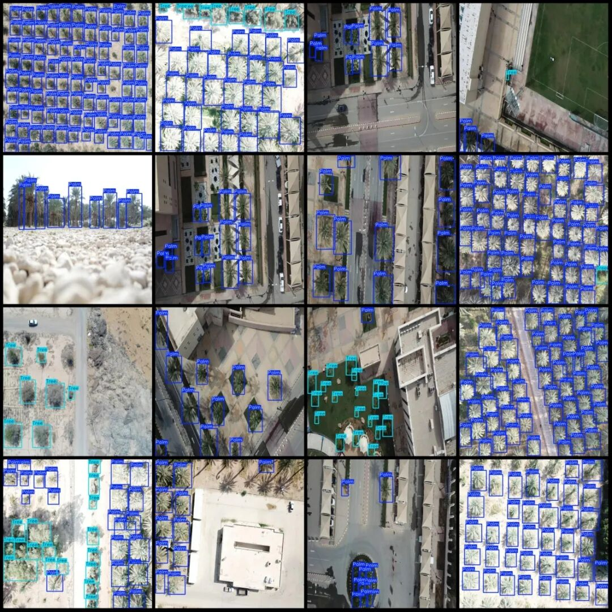

# UAV Perspective Palm Tree Detection Dataset VOC+YOLO format with 338 images in 2 categories

Dataset format: Pascal VOC format + YOLO format (txt file without split path, only containing jpg images and corresponding VOC format xml files and yolo format txt files)

Number of images (number of jpg files): 338

Number of annotations (number of xml files): 338

Number of annotations (number of txt files): 338

Labeling category count: 2

Label category names (Note that the order of yolo format categories does not correspond to this, but is based on the classes.txt in the labels folder): ["Palm", "Tree"]

Number of boxes labeled in each category:

Palm Frame Count = 10618

Tree frame count = 1867

Total frame count: 12485

Image resolution: 640x640

Drone: DJI Mavic Pro Capture height: 100m Capture angle: 90°

Application Scenario: Used for urban greening statistical analysis, yield estimation detection, large-scale forest area survey and other low altitude target detection fields.

Using labelImg:

Annotation rules: Draw a rectangle around the category.

Important Notice: No

Special : This dataset does not guarantee the accuracy of the trained models or weight files.

Image Preview:

Annotation example:

## Payment

Here is a pay link on Stripe ( https://buy.stripe.com/3cs8yP7sY87d0vu9AB ). Please contact me lonlonago@foxmail.com after funding $89, and I will send you a complete data files , thank you!

